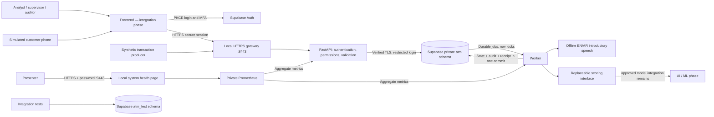

# Backend architecture and trust boundaries

## Chosen design

A modular FastAPI application and one worker share Supabase PostgreSQL. Supabase Auth is the sole deployed identity provider. Only loopback HTTPS ports are exposed through the local gateway. The browser talks to the API; it cannot query financial tables directly. The database is always hosted in Supabase, including the isolated integration-test schema.



### Why this structure

- **One deployable backend with modules:** contracts, identity/session validation, domain services, views, management workflows, worker and provider interfaces have separate responsibilities. This avoids a network of services before the project needs one.
- **One durable store:** PostgreSQL row locking (`FOR UPDATE SKIP LOCKED`) dispatches work. State, audit and job acknowledgements commit atomically. Redis/Kafka were earlier options, not dependencies of this implementation. Add a separate broker only when measured workload warrants the added recovery/operations complexity.
- **Database separation by privilege:** the deployed app cannot provision identities or migrate schemas. Supabase Auth owns credentials. Test roles have no access to application tables; tests cannot clear the application schema.
- **Explicit provider boundary:** a scorer returns a bounded, validated result. No approved scorer means a visible processing failure and an unscored manual-review case after bounded retries. A model cannot approve or execute actions. Jev is not integrated and must use this replaceable boundary if evaluated later.
- **No hidden demo fallback:** test scoring always labels its results as simulated. Running application configuration disallows it. Bank action receipts are simulated and say so explicitly. There is no live bank connection.

## End-to-end use case

A synthetic producer sends a transfer of 125,000 minor SAR units with a unique external ID and retry key. The API checks its identity, team, field types and timestamp, then commits the transaction, audit event and scoring job together. Duplicate delivery returns the existing record; changed content with a reused key is rejected.

The worker claims the job. Once a genuine scorer is integrated, it will record model identity, score/reasons and the active approved risk-policy version. A provider's mandatory-review flag cannot be suppressed by a threshold; no approved policy means review is required. The worker computes immutable account features over one-hour, 24-hour and seven-day windows. The current deployed configuration leaves scoring disabled; after bounded retries it creates an unscored case for manual review. The complete human workflow can therefore proceed without inventing an ML result. A bounded HTTPS adapter is implemented for later integration with an independently approved model service.

For a review case, the authorized analyst retrieves only scoped evidence that occurred no later than the case transaction and was received before the case was created. They start an investigation and an English or Arabic simulated call assigned to one participant. That participant answers or declines. Answering records the bank introduction and queues offline speech. Bank and customer turns share a versioned conversation; other participants cannot read or answer it. A timeout/hangup releases the case back to review.

The analyst proposes a hold bound to this transfer. A different supervisor reviews current evidence and approves with fresh MFA. The case cannot close or change evidence while that approved action is unfinished. The worker refreshes the approval and rechecks the evidence under the case lock, then writes one simulated execution receipt. A supervisor can cancel before execution with a reason; whichever operation wins the lock determines the outcome. Executed actions cannot be cancelled, and retries never execute a cancelled action. The analyst records a final fraud/legitimate/inconclusive decision. Reviewed decisions can be exported in a hashed training snapshot; registration/review of a later training result is distinct from actually training or deploying a model.

```mermaid
sequenceDiagram
    participant Producer
    participant API
    participant DB as Supabase
    participant Worker
    participant Analyst
    participant Customer
    participant Supervisor
    Producer->>API: Validated synthetic transaction + retry key
    API->>DB: Atomic transaction + audit + job
    Worker->>DB: Claim job and store score/case
    Note over Worker,DB: Genuine models remain an ML integration; failed scoring opens an unscored review case
    Analyst->>API: Start investigation and scoped call
    Customer->>API: Answer, reply, hang up
    API->>DB: Versioned conversation and audit
    Analyst->>API: Propose hold for this case
    Supervisor->>API: Independent approval + recent MFA
    API->>DB: Approval + execution job + audit
    Worker->>DB: One simulated receipt
    Analyst->>API: Final reviewed decision
    API->>DB: Decision + case completion + audit
```

## Permissions

| Identity | Permitted scope | Key restrictions |
|---|---|---|
| Ingestion | Submit/read its team's transactions | Cannot investigate or approve |
| Analyst | Unassigned or assigned-to-self cases in its team | Cannot read another analyst's assigned case or approve high-impact actions |
| Supervisor | Team review, assignment, high-impact approval, policy/model review | Cannot approve its own high-impact proposal; fresh MFA required |
| Auditor | Team case/evidence and audit reads | Cannot mutate cases or approvals |
| Admin | Team job operations, policy/model registration, training handoff | No default case access or identity administration |
| Participant | Calls explicitly assigned to that participant | Cannot select another account, approve a proposal or view other calls |
| Operator | Explicit out-of-band access provisioning | Separate credential, named access record, audited changes |

## Threat model and controls

| Threat / boundary | Implemented control | Remaining qualification |
|---|---|---|
| Browser changes IDs or roles | DB-authoritative principal, team/case/participant checks, hidden foreign objects | Real frontend negative tests |
| Forged/stale credentials | Fixed issuer/audience/algorithms, JWKS, lifetime checks, local/provider revocation, MFA age | Real Supabase MFA/key-rotation exercise |
| Replayed calls/actions | Versions, unique constraints, strict booleans, expiry, immutable evidence | Real external-bank reconciliation is out of scope |
| Malicious transcript/model output | Treated as data; bounded text/result contracts; action target derived from case; human approval | Tool-using AI sandbox/provider evaluation in AI phase |
| Cross-schema test damage | Separate restricted cloud test roles; fixture checks lack of app-schema usage | CI secret/environment review |
| Compromised API process | Restricted runtime login, no DDL/role administration, no audit rewriting | Runtime still spans teams; external audit archive and operator controls |
| Resource exhaustion | Body/page/turn/audio bounds, authenticated rate limits, connection/query limits, bounded retries | Public ingress limits/WAF and measured load test |
| Information leakage | Explicit response fields, redacted errors/logs, protected audio/evidence, no public DB access | Cloud backup/retention/residency review |

## Maintenance rules

Keep business changes in domain services and database migrations; the frontend must never own approval logic. Use explicit response fields and stable error codes. Add providers through interfaces with bounded timeouts and validated results. Preserve idempotency keys, model/policy identity and evidence timestamps. Do not deserialize uploaded model pickle files or accept arbitrary URLs/paths as provider input.

Apply SQL changes through Supabase migrations and keep `atm` and `atm_test` structurally aligned. Run the test suite under the restricted test-runtime identity, not the schema owner. Test fixtures alone use the test owner. Keep both credentials out of application containers and browser assets. Dependency and base-image upgrades require lockfile/digest updates plus targeted verification; the CI configuration is supplied but its hosted execution needs a configured repository environment.

## Measured operational limits

The 100-item ingestion path uses shared ordered retry locks and grouped database reads/writes. A real Supabase test accepted a 100-item batch in 5.77 seconds with seven application database statements; retries and overlapping batches preserved exactly one transaction/job/audit record per unique input. This is a bounded acceptance measurement, not 100 TPS or model-scoring performance. See [requirements traceability](REQUIREMENTS_TRACEABILITY.md) and the retained load reports.

Database revision 0008 is applied to application and test schemas. Approved policy versions include an optional daily review target and strictly ordered severity thresholds. Scoring records the policy and severity on each transaction so later changes do not rewrite historical evidence. Supervisors/auditors see daily opened/completed counts and capacity warnings; exceeding capacity never drops a case. Database triggers require new policy versions rather than mutation of approved settings.
