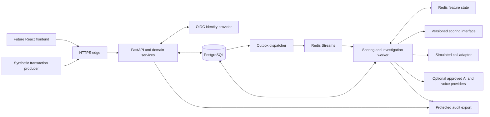

# Backend implementation and security plan

> Historical review/design baseline. The current implementation and Supabase-only decision are recorded in [BACKEND_STATUS.md](BACKEND_STATUS.md) and [ARCHITECTURE.md](ARCHITECTURE.md). Earlier local PostgreSQL/Redis suggestions are superseded.

Prepared 11 October 2026 from the SPAP proposal, repository review, and the user's follow-up decisions.

Status: proposed architecture and implementation backlog. No controls in this document are certified or verified merely by being listed. This plan does not change application behavior.

## Confirmed scope and delivery order

The simulated bank call remains a required product feature. The backend must support customer verification conversations in English and Arabic, analyst review, and simulated protective actions. It must not integrate with a live bank or process real customer data under the current proposal.

The requested order is backend, database, frontend, then AI/ML improvement. Backend domain rules, API contracts, authorization, workflow orchestration, and provider interfaces can be built first with deterministic test adapters. Durable approvals, audit, authentication sessions, and recovery cannot be declared complete until the database integration phase passes. The final AI/ML phase replaces test scoring with genuine inference and validates accuracy, explanations, and real scoring performance.

The security baseline is OWASP ASVS 5.0 Level 2, supplemented by risk-driven controls for privileged actions. The user also requested a mapping to Saudi NCA and SAMA requirements. This is a project security target and control mapping, not a claim of organizational regulatory compliance. The deployment owner must establish applicability, governance, and independent assessment before any real financial deployment.

## Architecture decision

Keep FastAPI. Build one modular Python application, with an API process and a separately running background worker sharing domain services. Keep identity, data, and queue infrastructure on private connections. Avoid splitting the application into independently deployed microservices until operational requirements justify it.



The browser talks to the backend, never directly to the database, queue, or model provider. The language model gets narrowly scoped tools; it cannot query arbitrary data or approve its own action. Customer speech is evidence, not an authorization command. Detection and investigation are separate workloads so a slow conversation cannot block transaction scoring.

### Selected tools

| Responsibility | Proposed tool | Rationale and boundary |
|---|---|---|
| HTTP service | FastAPI + Uvicorn | Reuse the existing framework; versioned APIs and explicit dependencies. |
| Data contracts | Pydantic v2 + pydantic-settings | Strict approvals, bounded inputs, validated startup configuration. |
| Identity | OpenID Connect; Keycloak for the self-hosted project profile | Central login, MFA and identity lifecycle. Authorization still runs in the backend. |
| Persistence integration | SQLAlchemy 2 + psycopg + Alembic | Defined transaction boundaries and reviewed migrations in the database phase. |
| Stream and feature cache | Redis Streams + redis-py | Acknowledged work, bounded retries, feature state, and rate-limit state. PostgreSQL remains the durable source of truth. |
| Outbound integrations | HTTPX and provider SDKs behind adapters | Fixed allowed destinations, timeouts, budget limits and typed results. |
| Dependencies | uv with a committed lockfile | Repeatable development and CI; reviewed upgrades rather than floating installs. |
| Quality | Ruff + mypy | Consistent formatting, lint and type checks. |
| Testing | pytest + HTTPX; Hypothesis for state invariants; real infrastructure integration tests | Verify business behavior, authorization, race handling and recovery. |
| Security checks | Semgrep, pip-audit, Gitleaks, Trivy, OWASP ZAP | Source, dependency, secret, container and authenticated test-environment checks. Findings require triage. |
| Performance | Locust | Sustained traffic and failure/recovery testing against defined hardware. |
| Observability | Structured logs + OpenTelemetry + Prometheus/Grafana | Request/job correlation, queue age, latency and failures without logging raw sensitive payloads. |
| Packaging | Docker Compose; HTTPS reverse proxy for a shared deployment | Repeatable local stack; non-root containers, private service networks and controlled ingress. |

Pin supported, compatible versions when implementing; this plan deliberately does not invent a latest-version list. Scanner and identity-provider configuration are part of the deliverable, not security guarantees conferred by installing a tool.

References: [FastAPI deployment concepts](https://fastapi.tiangolo.com/deployment/concepts/), [Pydantic strict mode](https://docs.pydantic.dev/latest/concepts/strict_mode/), [Keycloak OIDC](https://www.keycloak.org/securing-apps/oidc-layers), [SQLAlchemy transaction handling](https://docs.sqlalchemy.org/en/20/orm/session_basics.html), [uv locked environments](https://docs.astral.sh/uv/concepts/projects/sync/).

## Complete backend feature scope

| Module | Required behavior | Proposal coverage |
|---|---|---|
| Identity and access | Login/session lifecycle, account disablement, MFA, roles, case access, service identities | Security foundation |
| Transaction ingestion | Single and bounded batch input, schema validation, duplicate prevention, accepted/rejected processing status | FR1 |
| Account evidence | Authorized account/device history with an enforced as-of boundary and pagination | FR2, FR7 |
| Feature orchestration | Versioned feature contract, rolling-state interface, per-account ordering, cold-start and late-event policy | FR2 |
| Scoring orchestration | Supervised/anomaly interfaces, model availability, risk policy and explainability contracts | FR3–FR6 |
| Alerts and cases | Queue filters, stable pagination, severity, assignment, evidence, notes, case lifecycle and concurrency control | FR7 |
| Investigations | Start, cancel, resume, limits, scoped tools and structured agent findings | Retained agent feature |
| Simulated calls | Ring, answer, decline, speech/text turns, hangup, timeout, language, transcripts, protected audio access | Retained phone feature |
| Decisions and approvals | Separate case disposition from protective-action approval; strict validation and privileged-action checks | FR8 |
| Action execution | Approved action only, exact target binding, idempotency, mock execution receipt, failure/reconciliation | Simulation scope |
| Audit and evidence | Durable attribution, protected append-only records, export authorization and retention policy | FR8, NFR7/security |
| Configuration and monitoring | Versioned thresholds, effective time, change approval, queue/service health and model metrics | FR10 |
| Retraining and model lifecycle | Reviewed-label export, job status, dataset/model versions, evaluation/promotion/rollback interfaces | FR9 |
| Drift interface | Store and serve drift results and monitoring status once the ML implementation is ready | FR11 |
| Operations | Health/readiness, recovery, controlled deployment, backups, incident procedures and performance evidence | NFR1–NFR6 |

Stub scoring must return an explicit `simulation` indicator and a synthetic model identifier. Absence of a real model must never silently turn into a legitimate-looking risk score or a claim that FR3–FR6 are complete. Unavailable scoring produces a pending/failed status and an operational alert, not an automatic normal verdict.

## Domain and API contracts

Use `/api/v1` routes and a checked-in OpenAPI contract. Define request, response and event schemas separately from database models to prevent accidental field exposure or mass assignment. Clients cannot set roles, approval state, scores, execution outcomes, reviewer identity or audit timestamps.

Representative routes form the implementation backlog; the exact OpenAPI specification will be produced in the backend foundation phase.

| API group | Operations | Key rule |
|---|---|---|
| `/auth/*`, `/me` | OIDC login/callback, logout, identity and permissions | Application handles sessions, not its own password database. |
| `/transactions` | Submit, batch submit, read processing status | Ingestion service identity; scoped idempotency key and durable receipt. |
| `/accounts/{id}/history` | Read paginated evidence | Access checked per account; enforced as-of timestamp. |
| `/alerts`, `/cases` | Search, read, assign and add notes | Role plus team/case authorization on every operation. |
| `/cases/{id}/investigations` | Start, inspect, cancel and resume | Case-scoped workflow; bounded resource consumption. |
| `/investigations/{id}/calls` | Open simulated call and inspect state | Caller cannot choose an arbitrary real destination. |
| `/calls/{id}/turns`, `/calls/{id}/end` | Submit a customer turn or hang up | Restricted simulation participant, call ID and expected turn ID. |
| `/calls/{id}/audio/{clip_id}` | Read permitted speech output | Recheck case/call permission; opaque clip ID, no user-supplied path. |
| `/cases/{id}/action-proposals` | Propose an allowlisted simulated action | Proposal records target, payload, evidence version and expiry. |
| `/action-proposals/{id}/approval` | Approve or reject | Strict boolean, current authorization, exact proposal version and recent authentication. |
| `/cases/{id}/decisions` | Record disposition and reasoning | Reviewer comes from session; action approval is not a fraud label. |
| `/cases/{id}/events` | Reconnectable progress stream | Authorized, sequenced events; same-origin session, no tokens in URLs. |
| `/admin/risk-policy`, `/models`, `/training-jobs` | Versioned configuration and model/job lifecycle | Separate administrative and promotion privileges. |
| `/audit/events`, `/audit/exports` | Restricted searches and bounded exports | Access itself is audited; no raw transcript dump by default. |
| `/health/live`, `/health/ready`, internal metrics | Liveness, dependency readiness and telemetry | Public checks reveal minimal information; operational detail is restricted. |

Money uses exact decimal or integer minor-unit semantics with an explicit currency and conversion version. Event timestamps are timezone-aware and normalized for storage; the UI can display Riyadh time. Reject non-finite numbers, oversized strings/batches, invalid enums, unknown writable fields and inconsistent identifiers. The ingestion schema excludes labels and answer keys.

Return consistent errors with a request ID and stable error code. Do not echo tokens, SQL, stack traces or full input data. List endpoints use bounded cursor pagination and allowlisted filters/sort fields. An asynchronous `202 Accepted` means durably accepted for processing, not approved or fully scored.

### Workflow invariants

Cases follow allowed transitions such as `OPEN → IN_REVIEW → AWAITING_CUSTOMER → IN_REVIEW → RESOLVED`, with explicit escalation/reopening rules. Calls follow `CREATED → RINGING → ACTIVE → ENDED` or `DECLINED`, `TIMED_OUT`, `FAILED`, `CANCELLED`. Terminal calls cannot accept new turns. Proposals progress from `PENDING` to `APPROVED`, `REJECTED`, or `EXPIRED`; execution has separate `PENDING`, `SUCCEEDED`, `FAILED`, and reconciliation states.

Each transition checks identity, object access, expected version and current state. An approval binds the exact case, transaction, action, target and proposal version; changing any of these invalidates it. High-impact simulated freezes require an independent supervisor under the documented approval policy. A replayed click cannot execute twice. An AI response or customer statement cannot substitute for a human approval record.

Workers persist waiting state and release resources during customer/analyst waits. They resume from a new validated event rather than keeping a thread blocked for ten minutes. Browser disconnects do not lose cases. A durable event sequence allows reconnecting clients to resume progress. Parallel investigations cannot share a global session, transcript or approval channel.

## Security design

### Identity and authorization

Use OIDC Authorization Code flow with PKCE through a maintained client library. Prefer a same-origin backend session for the eventual browser client: Secure, HttpOnly cookies, appropriate SameSite, session rotation, CSRF protection on mutations, bounded inactivity/absolute lifetimes, and tested logout/revocation. Keep provider tokens out of browser local storage. Service ingestion uses a distinct short-lived, narrowly scoped identity.

Validate signatures, issuer, audience, expiry and allowed algorithms. Handle signing-key rotation safely; do not fetch a token-supplied key URL. Require MFA for shared analyst access and stronger/recent authentication for sensitive administrative or approval operations. Test disabled accounts and changed privileges against active sessions.

Define roles for analyst, supervisor, auditor, administrator, ingestion service and worker. Administration does not automatically grant case approval or unrestricted evidence access. Default deny, then enforce case/team assignment and operation permissions at the API and domain-service boundary. UUIDs are identifiers, not permission checks. No general unauthenticated demo bypass is allowed in a shared deployment. A limited simulation participant may answer only its own call and cannot read analyst evidence or approve actions.

### Confidentiality and provider boundaries

Use HTTPS at the edge, authenticated private service connections, and tested encryption for persistent volumes, backups and retained audio. Store keys separately from encrypted data and test rotation/recovery. Never put secrets in source, images or logs. Use separate development/test/shared-demo configurations and fail startup on insecure shared-deployment settings.

External AI, speech synthesis, and browser speech recognition can move content outside the backend. Default the repeatable demonstration to local/scripted speech and typed customer replies. Keep English/Arabic phone behavior available. Enable external providers only through explicit configuration, approved destinations, minimal synthetic payloads, timeouts, quotas and documented retention/location conditions. Do not assume browser speech recognition is entirely local.

Reject arbitrary external URLs and file paths. Audio IDs map to authorized server-side records; cache names alone do not protect access. Bound transcript length, audio duration and storage. Treat transcripts, model outputs and retrieved text as untrusted data. Give the agent evidence-read and proposal permissions only; no shell, arbitrary SQL, unrestricted network, identity administration or approval tool.

### Integrity and evidence

Commit a case decision, audit event and required dispatch record in one database transaction. Use an outbox to bridge database commits and queue publication; acknowledge jobs only after durable completion. Enforce uniqueness and version checks in the database, not only in API code. Repeated delivery must not create duplicate alerts, approvals or simulated actions. Test the crash window after an action attempt but before its receipt is persisted.

The runtime role cannot modify or delete audit history. Export audit records to separately controlled retention storage and verify integrity. Append-only application logic alone cannot prevent a privileged database operator from changing records; document that trust boundary. Keep security-event logs, business audit records and customer transcripts under distinct retention/access policies.

Use separate migration and runtime database identities, bounded connection pools, parameterized queries and transaction-scoped sessions. Do not share an ORM session across concurrent requests. Security decisions must use authoritative storage, not a stale cache alone. These boundaries apply the PostgreSQL best-practices skill's least-privilege and pooling guidance; no Supabase service is required.

### Availability and operations

Set request/body/concurrency limits, per-identity limits for ingestion and expensive operations, provider budgets, timeouts and bounded retries with backoff. Preserve per-account event ordering for feature updates. Define treatment of late events, cold starts and stale state. Cap retries and move repeatedly failing work to a reviewable failed-job queue.

Expose queue age, processing delay, error rates, authentication failures, approval denials and provider failures. Keep financial payloads and access tokens out of telemetry. Use non-root images, minimal capabilities, private database/Redis ports, narrowly scoped CI permissions and pinned build inputs. A WAF is an additional ingress control for an applicable exposed deployment; it does not replace application authorization.

Write incident, credential-rotation, backup/restore and rollback procedures. Set explicit recovery objectives and test them. Separate business fraud alerts from cybersecurity incidents; neither should disappear silently during a dependency failure.

## Saudi control mapping and evidence

Sources checked on 11 October 2026: [NCA ECC 2-2024](https://cdn.nca.gov.sa/api/files/public/upload/86e09090-44e4-481f-bc28-355673607654_ECC--2024-EN.pdf), [SAMA Cyber Security Framework](https://www.rulebook.sama.gov.sa/en/cyber-security-framework-2), and [OWASP ASVS 5.0](https://owasp.org/projects/asvs).

The following is an initial backend-focused mapping of our proposed measures to control areas, not an exhaustive statement of compliance or an equivalence between frameworks. Each selected area's individual requirements still need an applicability decision, accountable owner and verification evidence. The NCA text states its covered entities; SAMA addresses its regulated member organizations. A student simulation does not establish either status. Governance, physical security, personnel, vendor contracts and operational assessment remain beyond application code. NCA's Arabic text governs interpretation.

All rows below currently have status **Planned**. Future evidence records must use `Planned`, `Implemented`, `Verified`, `Gap`, or `Not applicable with rationale`, and include verifier, date, test/report link and environment.

| Project control area | NCA references | SAMA references | Evidence to produce |
|---|---|---|---|
| Threat model and secure development | 1-5, 1-6 | 3.2.1, 3.3.6 | Trust boundaries, abuse cases, reviewed requirements, security test results |
| Identity and scoped permissions | 2-2 | 3.3.5 | MFA configuration, role matrix, access review, cross-case denial and revocation tests |
| Protected application/ingress | 2-15 | 3.3.6 | Validation and authorization tests, HTTPS configuration, exposed-deployment WAF evidence or explicit gap |
| Encryption and classified data handling | 2-7, 2-8 | 3.3.9 | Data inventory, approved cryptographic configuration, key rotation and encrypted-backup checks |
| Security logging | 2-12 | 3.3.14 | Redacted events, access protection, retention configuration, detection and alert tests |
| Recovery | 2-9, 3-1 | 1.3 points to separate continuity requirements | Restore drill, queue recovery, model/application rollback and recovery objectives |
| Vulnerability handling | 2-10, 2-11 | 3.3.17 | Source/dependency/image scan triage, authenticated testing and independent penetration-test findings |
| Incident response | 2-13 | 3.3.15 | Incident playbook and tabletop exercise; regulatory communications remain an organizational responsibility |
| AI/voice suppliers and hosting | 4-1, 4-2 | 3.4.1–3.4.3 | Provider data-flow review, egress tests, retention/location records, required contracts and applicability review |

Two specific NCA items to track are the security-event retention minimum of 12 months (2.12.3.5) and the WAF requirement for applicable external web applications (2.15.3.1). These do not imply retaining every audio clip for 12 months. Retention and deletion must be set by data class. Any shortened local-demo retention must be documented as a demonstration limitation, not a satisfied control.

OWASP ASVS will supply the detailed application verification checklist. ASVS Level 2 includes applicable Level 1 and Level 2 requirements. Track each requirement individually; scans alone cannot establish conformance. Use [OWASP API object-authorization guidance](https://api-security.owasp.org/editions/2023/en/0xa1-broken-object-level-authorization/) to drive tests across cases, calls, clips, exports and administrative operations.

## Build phases and completion gates

| Phase | Deliverable | Gate before calling it complete |
|---|---|---|
| B1 Backend foundation | Package layout, locked environment, settings, errors, OpenAPI, domain types, CI and threat model | Clean setup; strict contracts; insecure configuration rejected; lint/type/unit checks pass |
| B2 Identity and permissions | OIDC/session integration, MFA profile, role/case policy, service identities | Tests reject invalid/expired/wrong-audience credentials, revoked access and cross-case requests |
| B3 Complete workflow logic | Ingestion, cases, investigations, retained calls, decisions, action proposals, model/provider interfaces | Deterministic API scenario passes; invalid transitions, stale replies and approval coercion are rejected |
| D1 Database integration | PostgreSQL schema/migrations, repositories, outbox, audit, retention and session persistence | Real PostgreSQL/Redis tests prove atomicity, duplicate resistance, parallel-case isolation and restart recovery |
| B4 Operational/security qualification | Hardened containers, monitoring, load harness, security checks and runbooks | Authenticated negative tests, restore drill, dependency-failure tests and reviewed security evidence |
| F1 Frontend integration | Existing phone adapter and later React client consume the same API | No privileged UI-only rules; browser sessions, reconnects and access denials tested end to end |
| M1 AI/ML completion | Genuine feature/model adapters, anomaly/fusion/explanations, drift and retraining | Reproducible quality evaluation plus actual-model latency and explanation tests |

This sequence preserves backend-first development without claiming database-dependent guarantees during an in-memory prototype phase. All features stay in the plan; the implementation order does not delete FR9–FR11 or the phone feature.

### Required acceptance scenarios

1. An authorized synthetic producer submits a transaction twice: one logical transaction and one processing result exist. Reusing its idempotency key with changed content fails.
2. Invalid amounts, currencies, times, extra privilege fields and oversized batches are rejected predictably.
3. Analyst A cannot retrieve, stream, answer, approve or export Analyst B's restricted case through changed IDs. Auditors cannot mutate cases; ingestion identities cannot review them.
4. Two investigations and calls proceed concurrently with isolated messages. A stale turn, ended call or wrong participant is rejected.
5. English and Arabic simulated calls support answer, decline, typed reply, speech playback, hangup and timeout. Provider outage preserves text interaction and records the failure.
6. `"false"`, `"no"` and `1` cannot satisfy approval. Only a valid strict approval payload from an authorized human for the current unexpired proposal proceeds.
7. High-impact approval policy blocks self-approval where independence is required. A changed action payload requires fresh approval.
8. Replayed approval, worker retry and crash recovery cannot execute a simulated action twice. Unknown outcomes enter reconciliation rather than being assumed successful.
9. Decisions, audit records and processing status survive restart. Failure to persist approval/audit prevents execution and reports failure.
10. Every evidence tool obeys the case's as-of boundary; transcripts and model output cannot expand its data access.
11. Provider timeouts, queue unavailability, database failure and expired sessions have bounded, observable behavior. Unscored transactions are not called normal.
12. Logs and API errors contain no credentials, raw audio, full transcripts or unnecessary account details. Protected clip and audit endpoints reject unauthorized access.
13. A clean environment starts with documented commands, no repository secrets and no default shared administrator password. Demo adapters cannot be enabled accidentally in the hardened profile.
14. A restore drill proves recovery objectives. Migrations are tested on representative data and rollback/forward-repair procedures are documented.
15. The final system is load-tested at at least 100 transactions/second on the stated four-core setup. Measure p95 from accepted ingress through queue wait, feature access, actual scoring, required explanation and durable result; target at most 200 ms. Report the actual result and component timings. AI conversation and human response times have separate measures. Mock-model results are infrastructure measurements only.

## Immediate implementation package

The first code increment should deliver B1 plus the strict proposal/approval and call-state domain contracts needed to remove the current global-state design. A proposed layout is:

```text
backend/
  pyproject.toml
  uv.lock
  src/atm_backend/
    main.py
    settings.py
    api/v1/
    domain/
    services/
    security/
    ports/
    adapters/
    workers/
    observability/
  tests/
    unit/
    contract/
    integration/
    security/
    performance/
```

Ports define storage, unit-of-work, scoring, explanation, agent, voice and audit behavior. Production adapters come in the relevant phases. Test adapters stay explicit and deterministic. Domain services contain business rules independently of HTTP routes and provider SDKs.

Preserve the existing call demonstration until its behavior is covered by tests and a compatibility adapter. Move its useful dialogue and presentation behavior onto scoped call endpoints; do not carry forward shared replies, implicit truthiness approval or unauthenticated global events. Keep old and new entry points clearly labeled during migration, with the legacy demonstration bound locally and excluded from the hardened deployment.

The release evidence package should contain the requirement coverage matrix, API contract, threat model, permission matrix, security-control register, automated results, manual review findings, benchmark report, and operating procedures. Every completeness claim must name the tested configuration and remaining limitations.
