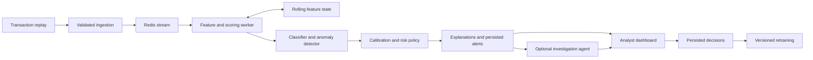

# Project assessment against the SPAP proposal

> Historical review/design baseline. The current implementation and Supabase-only decision are recorded in [BACKEND_STATUS.md](BACKEND_STATUS.md) and [ARCHITECTURE.md](ARCHITECTURE.md). Earlier local PostgreSQL/Redis suggestions are superseded.

Reviewed on 11 October 2026 against repository commit `fb0d405`.

Subsequent user decisions on 11 October 2026: retain the simulated bank-call feature; prioritize backend development, then database, frontend, and AI/ML completion; map security controls to Saudi NCA/SAMA as well as OWASP. The proposed implementation and verification sequence is recorded in `docs/BACKEND_PLAN.md`. The assessment below remains a snapshot of the reviewed code.

The project has a useful supervised-learning experiment and an interactive investigation prototype. It does not yet implement the integrated transaction-monitoring system described in the proposal. The highest-value next work is to make the data and evaluation reproducible, connect genuine model scores to persisted alerts, and complete the analyst decision workflow. The voice agent can then enrich that workflow.

This assessment preserves the proposal's scope as project context. It records observed implementation, reported experiment results, missing requirements, and recommended work separately. No application code was changed during the review.

## Proposal baseline

Source: `SPAP-Form - Detection of Suspicious Financial Transactions Using ML.docx`, supplied by the user from Downloads. All seven rendered pages and the document text were inspected. The document's guidelines were treated as source material, not as instructions to execute actions.

The intended contribution is integration: supervised detection of known suspicious activity, unsupervised detection of unfamiliar activity, calibrated score fusion, streaming scoring, per-alert explanations, an analyst dashboard, and feedback into retraining. The scope includes both fraud and suspicious money-laundering patterns.

The measurable objectives are:

- A reproducible pipeline with at least 500,000 transactions from public and synthetic sources.
- At least four supervised models compared under identical conditions.
- Recall at least 0.85 with false-positive rate at most 2% on a held-out time period.
- Anomaly evaluation on laundering patterns deliberately withheld from training labels.
- A calibrated 0–100 risk score and severity bands linked to analyst capacity.
- Scoring p95 at most 200 ms and sustained throughput at least 100 transactions per second on four cores.
- Five contributing features per alert, including direction and magnitude.
- Alert review, account history, persisted analyst decisions, and retraining.

Only public and synthetic data are in scope. Live core-banking integration, real customer data, regulatory submissions, sanctions screening, cryptocurrency tracing, and a native mobile app are explicitly excluded. Simulated protective actions are consistent with a demonstration; real bank actions would expand scope.

The voice investigation agent is an addition in the repository, not an explicit deliverable in the supplied proposal. It should not displace the core detection and analyst workflow. The proposal specifies eight weeks, but its risk table still says eight months and month one. That inconsistency needs an editorial correction when the team confirms the intended timetable. Its zero-budget commitment also calls for an optional, clearly documented external-AI mode with a deterministic offline demonstration mode.

## What the code currently does

### Data and training

`data/sample/transactions_mini.csv` contains 35,828 rows and 131 columns. It includes 1,305 fraud-positive rows and 10,523 AML-positive rows, with no overlap between those two positive sets in this sample. The sample spans January through September 2026 and contains precomputed behavioral features.

The notebook reports loading a larger dataset of 746,698 rows with 1,305 fraud-positive rows. That larger dataset and its generator are not present in this checkout. The sample is much more fraud-enriched than the full dataset reported in the notebook; it should not be substituted for the full evaluation dataset or treated as complete account history. The sampling procedure and correct sample weights are not documented here.

`notebooks/fraud_model_E05.ipynb` loads a CSV in Google Colab, creates eight extra feature combinations, removes selected identifiers and labels, one-hot encodes categories, and trains one XGBoost classifier. It uses chronological 70/10/20 row splits, compares a static-rule baseline, measures transaction and account-day performance, plots global feature importance, and exports artifacts.

`models/fraud_e05/` contains an actual XGBoost JSON model with 328 feature names, a pickle model, feature-column metadata, and saved settings. Metadata inspection confirms `eval_set = val`, an alert budget of six per day, and a threshold of approximately 0.010229. A serialized model exists; its full-data performance was not independently rerun during this review.

### Investigation demonstration

`src/agent/fraud_agent.py` loads transaction data and offers six tools: transaction lookup, account-history lookup, shared-device lookup, simulated customer conversation, ending the conversation, and proposing an action. Gemini or Claude drives the tool sequence. Explicit fraud labels are removed from transaction evidence. The history and device tools cap their time arguments at the current alert time.

The agent has useful boundaries: an action allowlist, a required approval callback, a one-call lifecycle, and a rule preventing proposals while the call remains active. Protective actions only produce mock execution results. These are worthwhile prototype components.

`src/agent/call_server.py` exposes a FastAPI interface around one in-memory investigation. `call_demo.html` provides a transaction selector, evidence activity, English/Arabic customer dialogue, browser speech recognition, generated or browser speech output, approval controls, and a final case summary.

The actual demonstration path is:

```text
CSV with known labels
  -> curated fraud examples and legitimate look-alikes
  -> user selects a transaction
  -> language model investigates with lookup tools
  -> optional simulated customer call
  -> analyst approval of a simulated action
  -> case summary and answer key in the browser
```

There is no model loading or prediction in the application source. `/api/alerts` uses `pick_df()`, which selects records by ground-truth labels. The demonstration therefore does not establish end-to-end detection performance.

## Requirement coverage

“Missing” means no implementation was found in this checkout; work may exist elsewhere.

| Requirement | Status | Evidence and remaining work |
|---|---|---|
| FR1 Transaction ingestion | Partial | CSV reading exists. No transaction ingestion endpoint, fixed input schema, stream consumer, or validation pipeline. |
| FR2 Rolling behavioral features | Partial data only | Relevant columns exist. `src/features/` contains only a placeholder; no reproducible rolling calculation or feature store. |
| FR3 Calibrated classification | Partial | XGBoost training and artifacts exist. No calibration implementation or serving connection. Target is specifically `is_fraud`. |
| FR4 Unsupervised anomaly score | Missing | No anomaly training or inference code. |
| FR5 Score fusion and severity | Missing | No fused score or severity policy. A notebook threshold is not score fusion. |
| FR6 Five alert contributions | Missing | Global feature importance and generated narrative do not implement per-alert feature contributions with direction and magnitude. |
| FR7 Analyst alert queue | Prototype only | A selector of curated examples exists. No model-generated queue, risk sorting/filtering, or analyst account-history screen. |
| FR8 Persist analyst decisions | Prototype only | Approval is held in memory. No durable decision, reviewer identity, or decision timestamp. Action approval is also different from a case disposition label. |
| FR9 Versioned retraining | Missing | No feedback dataset, training job, promotion process, or rollback. |
| FR10 Administration | Missing | No threshold administration or performance monitoring view. |
| FR11 Drift monitoring | Missing | No drift calculation or reporting. |
| NFR1 and NFR2 Performance | Unverified | No scoring service or load-test results. |
| NFR3 Data and encryption | Partial/unverified | Repository data are described as synthetic. No encryption-at-rest deployment configuration or evidence was found. Host-disk encryption was not audited. |
| NFR4 Reproducibility | Partial | A fixed model seed and saved outputs exist. Generator, full dataset access/version, complete environment lock, shared feature pipeline, and experiment tracking are missing. |
| NFR5 Usability | Unverified | A demonstration interface exists; the required analyst workflow and usability evaluation do not. |
| NFR6 Single-command start | Missing | Compose is empty; the documented generator entry point does not exist. |
| NFR7 Attribution | Missing | `ATTRIBUTION.md` is empty. Dataset licenses, external components, and AI-assisted contributions need entries. |

The repository has no automated tests or CI workflow. The dashboard, feature, serving, model-source, and explanation directories contain placeholders. This is best described as a research and interaction prototype, with the main integration still ahead.

## Model results and evaluation concerns

The saved notebook's validation output is:

| Measure | Recorded result | Interpretation |
|---|---:|---|
| Validation rows | 74,670 | 113 fraud-positive rows, 16 July–11 August 2026 |
| True positives / false negatives | 93 / 20 | Recall 82.30% |
| False positives / true negatives | 69 / 74,488 | False-positive rate 0.0925% |
| Precision | 57.41% | 93 of 162 flagged transactions are labeled fraud |
| Average precision | 0.732 | Notebook labels this PR-AUC |
| ROC-AUC | 0.999 | Recorded validation result only |

These numbers were read from saved outputs; only the confusion-matrix arithmetic was independently checked. Recall at the saved operating point is below 85%, and these are not final held-out test results. Another saved budget experiment reports 87.6% recall at 200 alerts across the validation period, suggesting that operating-point selection deserves study; it does not prove the test-period target is met.

The notebook introduction lists E05 PR-AUC as 0.658, while the execution output reports 0.732. The introductory comparison lists random forest, XGBoost, and neural-network variants, but their runnable experiments are absent. Multiple variants do not provide reproducible evidence of four supervised model comparisons under identical conditions.

The following issues should be resolved before presenting final performance:

1. **Availability at prediction time.** The stored model includes `balance_after`, status, and decline-reason features, including `SUSPECTED_FRAUD_BLOCK`. These may be unavailable or encode an existing decision if the system is supposed to score before authorization. Define the scoring moment and audit every feature against it. For retrospective monitoring, some can be legitimate, but the task and performance claims must then match that setting.
2. **Case overlap.** The split orders rows by timestamp but does not prevent the same `case_id` from crossing boundaries. As an illustrative check, 76 cases in the committed sample span midnight UTC on 16 July; this is not a reconstruction of the exact full-data split. Establish a documented purge/group policy for cross-boundary cases while preserving chronological evaluation.
3. **Delayed labels.** `label_available_at` is dropped rather than used to determine which labels were actually available at a training cutoff. In the sample, 1,067 rows before that illustrative cutoff have labels dated on or after it. An as-of training snapshot must exclude or treat those labels as unresolved, rather than silently using future knowledge.
4. **Preprocessing sees future categories.** `get_dummies` runs before the split, so the category vocabulary incorporates validation and test rows. This is not direct target leakage, but it weakens the deployment simulation. Fit preprocessing on training data and save it with the model. This follows [scikit-learn's guidance on preprocessing and leakage](https://scikit-learn.org/stable/common_pitfalls.html).
5. **Threshold selection uses the evaluated period.** The notebook chooses a threshold from all scores in `X_eval`. Switching to test repeats this on the test score distribution. That is retrospective ranking, not a fixed deployable threshold. It also allocates six times the number of days across the whole period rather than enforcing six alerts on each day. Tune the operating policy on past validation data, freeze it, then evaluate a chronological replay. Report retrospective top-k separately if useful.
6. **No calibration.** A `predict_proba` result is not evidence of calibrated probability. Reserve past data for fitting and checking a calibrator and report reliability and Brier/log-loss measures. Calibration data must remain independent of the estimator fitting data; see [scikit-learn's calibration documentation](https://scikit-learn.org/stable/modules/calibration.html).
7. **Weights and fairness promises are unverified.** The README calls for weighted metrics and exclusion or evaluation of sensitive proxies. The notebook drops weights and reports unweighted metrics; the stored feature list includes residency status, identity type, and counterparty country. Document the sampling/weighting rationale and report the promised subgroup analysis or change the feature policy.
8. **Fraud is not the entire suspicious-activity target.** AML-only rows have `is_fraud = 0`. That is appropriate for a fraud-specific classifier, but its output cannot establish that an AML transaction is normal. Define how the fraud and anomaly components cover suspicious activity and evaluate fraud, known AML, and withheld AML separately.

## Concrete implementation findings

### High priority before a shared demonstration

**The checkout cannot start as documented.** `fraud_agent.py:102–115` loads data at import and exits if neither `data/transactions.csv` nor its parquet cache exists. Neither exists here; the committed sample is at another path and is not used automatically. The error also incorrectly points to `src/agent`. `generator/main.py` and `DATA_DICTIONARY.md` are absent, and `docker-compose.yml` is empty. Add an explicit sample demonstration mode, configuration-based data paths, accurate startup checks, and a working setup command. Do not imply the sample contains complete behavioral history.

**Approval accepts arbitrary text as truth.** `call_server.py:169–172` converts the response with `bool(...)`; the shared reply schema at lines 264–272 accepts strings or booleans. Isolated execution of the actual approval function confirmed that both `"false"` and `"no"` return approval. Use separate typed customer-reply and approval endpoints, require a strict boolean, and bind approval to a particular case and action request.

**Approval is not tied to an authenticated reviewer.** The server has no authentication or role checks. All clients share `S`, and a response is applied to whichever prompt is currently waiting. The start check and state mutation are not atomic. The default localhost binding limits exposure, but this design cannot support a shared or multi-worker deployment. Persist case state, scope events/replies by case and request IDs, authorize access, reject stale responses, and make action application idempotent.

**Audit and case records disappear.** The agent clears `ACTION_LOG` for each investigation; the server clears events when another one starts. Records lack durable storage, reviewer identity, and timestamps. Save transactions, feature/model versions, alerts, dispositions, approvals, and action outcomes in a database, with an append-only audit trail. Keep simulated action execution explicitly labeled.

### Model evidence and reliability

**The time boundary is bypassable.** `get_transaction` at `fraud_agent.py:127–138` does not enforce `ALERT_TIME`, although history and device lookup do. An isolated call returned a September transaction while the alert time was set to January. Apply the boundary and case authorization consistently to all tools.

**Case JSON is parsed but not validated.** `parse_result` at lines 398–404 accepts any JSON object. A probe accepted confidence 99 and a claimed action with required fields missing. Validate a typed result with bounded confidence and allowed dispositions. Derive executed-action facts from the durable approval/action record, not from generated prose. An agent's self-reported confidence must not be displayed as calibrated transaction risk.

**Several safeguards exist only in prompts.** The code enforces an action allowlist and approval callback, but it does not enforce every required investigation step or ensure exactly one proposal. Customer text and retrieved fields can also carry misleading instructions. Use an explicit server-side state machine, authorized evidence access, structured tool/result validation, and adversarial tests. Evaluate evidence faithfulness and unsupported-action claims separately from detection quality.

**Timeout and provider failures need recovery.** A timed-out `Session.wait_for` leaves its pending reply reference intact. Provider failures can interrupt cleanup; polling retries indefinitely. Introduce explicit failed/cancelled states, cleanup in `finally`, bounded provider timeouts/retries, cancellation, and a recoverable UI. Persist state before emitting completion events.

**Dependency and artifact handling need one reproducible contract.** Agent requirements are unpinned; model requirements omit direct notebook dependencies such as joblib and matplotlib. The notebook is Colab-specific and preprocessing remains embedded in it. Save one versioned inference bundle: model, preprocessing, feature schema, calibrator, threshold policy, dataset/config hashes, and metrics. Prefer the existing native model format and simple JSON metadata over unnecessary executable pickle metadata.

## Recommended implementation path

### First establish a reproducible foundation

Recover the original generator and data dictionary if they exist elsewhere. Record the generator seed, full dataset version/checksum, source licenses, sample construction, and public-dataset acquisition procedure. Do not replace the original generator with a new approximation and claim the old results are reproduced.

Create a shared, tested feature pipeline used by offline training and online replay. Establish feature availability, event-time ordering, same-timestamp behavior, cold starts, and late/duplicate transaction handling. Separate evaluation labels from the inference schema. Add a locked environment and a deterministic sample startup path that does not require an external AI key.

Resolve target definitions, delayed labels, case separation, and threshold policy before tuning. Run at least four reproducible supervised baselines, for example logistic regression, random forest, XGBoost, and LightGBM, under the same splits and evaluation policy. Preserve the final test period until the protocol is fixed. Evaluate on an independent public dataset with documented feature limitations; do not imply that incompatible datasets support the same feature set.

### Build one complete transaction-to-decision workflow

The first integration milestone should accept a transaction, validate it, compute the same features used offline, score with E05 as a provisional baseline, attach actual feature contributions, create a durable alert, and allow an analyst to record a disposition that survives a restart. Mark the provisional model's limitations visibly in project documentation.

Use a small modular backend plus a background worker, PostgreSQL, Redis, and a React/TypeScript dashboard, matching the proposal. Redis Streams is a reasonable initial choice because Redis is already planned for feature storage; its consumer groups support acknowledged processing and recovery. Consumers must be idempotent because messages can be delivered more than once. See [Redis's streaming documentation](https://redis.io/docs/latest/develop/use-cases/streaming/).



Keep model scoring independent of customer conversations and remote language-model calls. The 200 ms target should have an explicit measurement boundary covering ingestion, feature access, scoring, and the required decision output; report explanation time and queue delay honestly. Investigation and customer dialogue run after an alert exists, with their own latency measures.

### Complete the second detection layer and explanations

Start with a reproducible anomaly baseline such as Isolation Forest and a documented feature/normalization policy. Reserve withheld typologies according to a declared novelty protocol and make their ground truth available only to evaluation. Measure what the anomaly layer detects beyond the supervised model at a comparable review budget. Add an autoencoder only if it provides a measured benefit.

Do not label an arbitrary average of classifier probability and anomaly score as a calibrated probability. Normalize/learn fusion on separate past data, define which outcome it predicts, and validate the fused score. Preserve component scores and model versions for investigation. For each alert, report five attributable features with values, directions, and magnitudes. If SHAP explains only the supervised component, label that limitation and provide a defensible explanation of the anomaly/fusion contribution as well.

### Make the analyst workflow professional

Prioritize a usable case queue with risk, age, status, and assignment filters; a case detail view with transaction/account timelines; and a decision form with clear dispositions and notes. Include analyst identity, timestamps, decision history, model version, component scores, and explanations. Distinguish approving a protective action from deciding whether a transaction is suspicious.

Provide loading, empty, error, and disconnected states; keyboard-accessible controls; unambiguous dates/time zones; and explicit labels for synthetic data and simulated actions. If Arabic is a product requirement, support it across navigation, forms, dates, and right-to-left layout, not only the voice dialogue. Keep answer keys in a separate evaluation mode.

The existing agent can become an optional investigation panel with cited evidence and action proposals. Measure its incremental value through case completion, evidence accuracy, analyst time, tool failures, and cost. Preserve a usable dashboard when the AI provider is unavailable.

### Demonstrate completion with evidence

Add unit and integration checks for causal rolling features, training/serving consistency, duplicate delivery, persisted decisions, unauthorized or stale approval, provider failure, and restart recovery. Use simulated providers for deterministic CI. Run load tests on the stated four-core configuration, report p50/p95/p99 and achieved throughput, and include explanation/persistence costs according to the declared boundary.

Implement retraining from reviewed labels with their availability times, versioned datasets/configuration, a comparison to the current model, promotion criteria, and rollback. Analyst feedback is selective; do not equate every action approval with a confirmed fraud label. Add drift monitoring after the must-have workflow is stable.

## Team priorities and acceptance gates

These assignments follow the proposal's existing responsibilities and are recommendations, not new commitments or deadlines.

| Owner | Next deliverable | Acceptance evidence |
|---|---|---|
| Yousef Alyousef | Recover/version data and build causal feature pipeline | Documented sample/full-data provenance; reproducible features; delayed-label and split checks; offline/online parity |
| Mohammad Aldemaiji | Reproducible supervised comparisons and calibration | Four runnable models, fixed evaluation protocol, calibrated operating policy, archived metrics |
| Abdulrahman Shikmakanik | Anomaly baseline and withheld-pattern evaluation | Declared novelty protocol, independent evaluation labels, incremental detection results |
| Salman Almadi | Scoring, persistence, stream worker, deployment | Transaction-to-alert path; restart-safe decisions; one-command setup; latency/throughput report |
| Mohammed Nasser | Analyst queue, case view, decisions, explanations | Actual scored alerts, five attributable features, usable decision capture, brief usability findings |
| Whole team | Integration and documentation | FR/NFR evidence checklist; CI; attribution; architecture and deployment guide; repeatable demonstration |

Complete the work in dependency order: reproducible data and evaluation; a complete persisted workflow; anomaly/fusion; reliability and measured performance; then optional agent refinements and presentation polish. Set dates after confirming the team's current deadline and whether missing components exist outside this checkout.

## Verification scope

The review inspected all tracked implementation files, the notebook's code and saved outputs, model JSON/metadata, sample records, and the rendered proposal. Python source passed syntax parsing. Isolated execution of existing functions reproduced missing-data startup behavior, future-transaction access, permissive case parsing, and text-to-approval coercion. Those probes bypassed import-time data loading and external services; they were not full API integration tests.

No provider calls, real customer calls, deployments, model retraining, or live banking actions were performed. The review environment lacked XGBoost, scikit-learn, FastAPI, and several other application dependencies; the full training dataset was also absent. Accordingly, model accuracy, browser behavior, and production throughput remain unverified. Claims of completed functionality are limited to code/artifact evidence and the checks explicitly described above.

This review was prepared with AI assistance. Include it, along with relevant assisted code/document contributions, when completing the project's attribution record.
